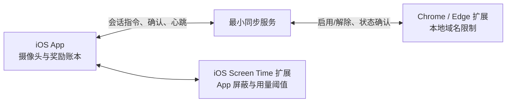

# WorkToScroll — DESIGN v0.2

## 设计索引

- 2026-09-08 Roy 已授权降负载试用：CameraX 预览与分析以 ResolutionSelector 请求 640×480，设备支持时请求 15fps，PERFORMANCE 预览；识别仍约 2Hz，计时/奖励规则不改。理由是减少持续采集、图像转换及显示负载；实测收益未确定。两版各 10 分钟、相近起温及同源测温的对照见[发热任务](../tasks/active/camera-thermal-test.md)，技术实现及回退边界见 [ARCHITECTURE](../ARCHITECTURE.md)。
- [应用图标与备选归档](design/app-icon-exploration.html)：2026-09-08 Roy 确认先采用 C 标准沙漏修正版，紫底、暖白票券与清晰沙漏；原 C、A/B、C2/C3 保留为备选，不自动切换。图标决定不改变首页猫总或产品规则。
- [界面与角色设计](design/interface-and-roles.md)：当前采用 C「猫总监工」，A「电脑＋笔记簿 / 小红书」保留为设计参考；图稿、页面分层、素材及交互边界在该文件维护，本文保留总入口与技术路线。
- [待探索：用户选择监督角色](design/interface-and-roles.md#role-exploration)：角色候选与待验证问题；仅记录创意，不属于当前实现范围。
- 产品行为与验收要求以 [SPEC](SPEC.md) 为准；实际结构见 [ARCHITECTURE](../ARCHITECTURE.md)，当前执行停点见 [任务索引](../tasks/README.md)。

> **当前 Android 摄像头阶段（2026-09-08，用户已确认）**：Roy 要求人体观察与两种检测声音直接进入日常主 App，在实际使用中验证手机侧后方机位。采用 CameraX 1.4.2 + MediaPipe Tasks Vision 1.0.0 / 随包 EfficientDet-Lite0 int8，全画面识别 person；按 Roy 纠正保持前置镜头，手机摆在侧后方，固定机位、亮屏前台。可靠人体仅一人时接入现有 WorkClock，弱分或多人不确定即暂停；保留 1 秒确认、3 秒离开宽限及全部每轮奖励/3 分钟重置规则。检测原始变化由两段随包 WAV 提示，首次明确结果和切换时播一次，不等待计时宽限、同状态不复读，声音可关闭。没有网络权限，不保存图像；侧后方长期识别稳定性、发热与误判仍待验证，不声称证明正在工作或识别身份。另一部手机、区域校准、复杂行为、PC 和云同步暂不进入本轮。实际验证见[侧后方任务](../tasks/active/side-rear-presence-exploration.md)，实验与主 App 的证据分开记录。iPhone 暂缓。

> **暂停的 iPhone 范围（2026-09-07 确认，2026-09-08 暂缓）**：先在 Roy 自己的 iPhone 上验证“授权 → 选择小红书 → 零余额限制 → 加入测试额度 → 按实际使用扣减 → 耗尽重锁”，核心路径通过后再加入摄像头和电脑联动。TestFlight 不作为首期安装前提。保留 [iPhone 草案](design/ios-design-draft.md) 供以后恢复，不代表当前开发优先级。

> **当前 Android 选择（2026-09-07，用户已确认）**：Roy 对照两版的真机警告后选择“使用情况访问 + 普通悬浮窗 + 带通知的前台服务”，作为当前继续采用的 Android 路线。理由是去掉了无障碍的额外敏感授权；使用情况访问仍有明显信任门槛，不把风险写成已消除。应用 ID 继续为 `com.roy.worktoscroll.overlaytest`，不迁移或覆盖原版数据。Xiaomi 授权优先通过本应用详情页和已核对的操作说明定位悬浮窗项，引导弹窗只保留本应用设置入口和取消，无法启动详情时仍自动回退到标准列表；其他厂商保持标准入口。2026-09-08 已确认默认开启与停止提醒：采用 `START_STICKY`、开机/本包更新接收器请求恢复，尊重手动停止，中断期间不补扣。路线选择不代表五分钟消费、所有返回路径、长期后台或商店审核已通过。实际结构见 [ARCHITECTURE](../ARCHITECTURE.md)，验证进度见 [任务索引](../tasks/README.md)。

> 当前状态：技术路线讨论稿  
> 悬浮窗授权交互取舍：Xiaomi 引导只呈现一个设置入口，避免让首次授权用户在两条路径间判断；“应用列表入口”按钮及说明已按 Roy 要求移除。标准列表仅用于详情页启动异常时的自动回退，不再作为并列选项。
> 对应需求：[SPEC v0.4](SPEC.md)\
> 历史基线名称：`Work_to_Scroll_DESIGN_v0.1.md`（当前项目未包含该原件）  
> 修订日期：2026-09-07

> 适用范围校正：当前已确认先做 Android 私有 Gate 1 原型，不等待 iPhone；这不等于最终发行平台已改为 Android。本文保留原 iOS 与 PC 联动候选方案，不代表相关组件已经实现。实际代码见 [ARCHITECTURE](../ARCHITECTURE.md)，当前验证结果和停点见 [任务索引](../tasks/README.md)。本次只同步已确认的阶段边界，不新增产品决定。

## 状态边界

摄像头工作页外观（2026-09-08，Roy 明确要求）：黑色背景、柔和浅色文字与深灰按钮，系统栏沿用深色外观，降低持续亮屏的刺眼感。仅调整工作页，保持原有计时、摄像头与奖励规则。

每轮门槛与低频奖励（2026-09-08，Roy 确认修订）：每轮十分钟得五分钟，之后每分钟得三十秒；连续中断不足三分钟续接，达到三分钟清除本轮有效进度、余量及分钟奖励资格。已到账奖励和历史工作保留，主动结束后新一轮重新过门槛。这样每次重新投入都需先完成一段工作，门槛后仍有及时反馈；三分钟作为试用阈值，不额外限制短暂停次数。暂停页显示重置倒计时，误判导致的意外重置是重点失败信号。

有效计时用大字号，奖励为辅；工作页显示本轮时间和本轮已获得，首页显示历史累计与实际可用余额。成功到账后提示一次，约 2.2 秒停留后 0.6 秒淡出，本轮十分钟里程碑替代该次普通提示。不通过声音、震动、弹窗或逐秒奖励数字吸引注意。规则升级只从当前余额保留已有成果，不按历史总量补发或追回；旧的累计门槛资格不迁入新一轮。

### 已经确定

- 拦截音频处理（2026-09-08，Roy授权继续）：单靠共享音频焦点已被真机持续出声反馈否定，改为先浮层即时遮挡，再打开独立不透明阻止Activity，使目标真正退后台；新页实际获得窗口焦点后撤浮层，启动受阻则保留覆盖。独立页不随目标暂停自动消失，返回工具/桌面与系统返回均避免重新露出目标，不进入工作页栈。沿用权限、消费和奖励，不改音量或自动播放；共享音频焦点只作为浮层阶段辅助，Roy已接受可能影响后台音乐的边界。真机结果见[音频处理任务](../tasks/active/audio-blocking.md)。

- 猫总 UI（2026-09-08，Roy 授权实施）：C 为当前采用界面，原生首页展示真实余额与累计工作；设置集中管理权限、后台保护与开发工具，首次规则说明独立保存展示状态。黑色工作页的小猫仅映射现有在场/离开/奖励状态；不修改奖励、摄像头或后台保护算法。详见[界面设计](design/interface-and-roles.md)。

- 默认保护与余额简化（2026-09-08）：首次进入并完成必要授权后默认开启，系统中断保留开启意愿并尝试恢复；手动停止跨重开、跨更新保留，直到用户主动开启。首页显示实际运行/未保护状态，仅突出可用余额，待兑换余量内部保存而不显示。工作有效计时与低频奖励反馈不取消。
- 停止提醒（2026-09-08）：停止满四小时后，每次至少间隔四小时，仅当地09:00—21:00静默通知，夜间不补发，不响铃、不震动、不弹窗。用单次非精确定时与接收时复核实现，不增加一个常驻提醒服务；通知授权与系统调度会影响可达性。重启/时区变化后重排，开启保护即取消。系统强停后的自动恢复/提醒不作保证，需真实设备耐久验证。
- MVP 由手机摄像头判断人的可观察状态，不用手机摄像头读取电脑屏幕。
- PC 娱乐网站由 Chrome/Edge 扩展按域名限制，并与手机 Work Session 联动。
- 达到奖励节点不会解除 PC 限制，用户主动结束工作后才能消费奖励。
- 长期方向是电脑摄像头负责监测，手机负责 App 限制与奖励钱包。
- Android 沿用自用 APK 的普通悬浮窗限制与余额消费，新增本页顶部确认的最小摄像头工作奖励；人工加余额保留为可见测试工具，PC 同步与商店发布不在本阶段。
- iPhone 首期范围保留，当前因开发条件暂缓。

### 尚未确定

- iOS 是否能在目标真机和系统版本上稳定完成“按实际使用扣减、耗尽后重新限制”。
- 具体视觉模型、判断阈值、同步服务实现和异常宽限时间。
- 第 22 节列出的产品选择。
- 最终发行平台，以及 Android 限制路线的长期、跨机型可靠性和公开发布可行性。
- Android 在场检测的长期误判、耗电发热与异常恢复效果；拿另一部手机或机位移动等扩展检测仍未纳入本次最小范围。

除“已经确定”清单外，本文中的具体技术方案均为当前推荐路线，需要通过对应 Gate 验证后再据此实施。

### 待探索

- 用户选择监督角色（2026-09-08，Roy 要求记录）：用户可选择不同风格的监督者，参考包括盖世太保、锦衣卫（张震）、吃人博士、曾国藩、孔子等。角色清单、选择方式、造型和互动强度均未确定，详见[角色选择探索](design/interface-and-roles.md#role-exploration)。
- 当前已授权采用 C，A 保留参考；双主题切换与角色选择仍未确定，不随本轮 UI 自动进入实现。

## 0. 技术评估结论

这条产品路线整体可实现，但不能直接进入完整 MVP 开发。

原 v0.1 对“手机端限制 + 端侧摄像头判断”的方向基本正确，但遗漏了四项会直接决定产品能否成立的技术问题：

1. **iOS 发布许可**：公开发布前必须获得 Apple 允许 App 使用系统限制能力的权限。
2. **奖励余额的真实扣减**：Device Activity 提供按受限 App 实际使用时长触发阈值的机制，理论上符合“用多少、扣多少、耗尽重锁”；但该能力必须在当前 iOS 真机上验证准确性和稳定性。
3. **手机摄像头只能在 App 前台工作**：一旦 WorkToScroll 退到后台，iOS 会中断摄像头，因此 Work Session 必须保持本 App 在前台、屏幕保持唤醒；退后台后立即暂停有效工作时间。
4. **PC 网站限制需要独立执行端**：手机摄像头无法可靠读取电脑屏幕内容，必须由 Chrome/Edge 扩展在电脑本地识别域名并执行限制，再与手机同步会话状态。

因此，首要技术目标不是提高 AI 精度，而是先证明下面四个 P0 闭环：

- 小红书可被系统屏蔽、按奖励时间开放、耗尽后重新屏蔽。
- 手机摄像头可在 20—40 分钟真实 Work Session 中稳定运行，耗电、发热和误判可接受。
- 手机发起会话后，浏览器扩展能可靠启用和解除网站限制。
- 手机、扩展和异常恢复始终能对“当前是否正在保护”达成一致。

---

## 1. 设计目标

技术设计只服务于以下最小完整循环：

> 想刷 → 被挡 → 开始工作 → 摄像头验证可观察的工作状态 → PC 娱乐网站保持受限 → 挣得 Scroll Time → 主动结束工作 → 使用奖励 → 余额耗尽 → 再次受限

第一版不追求构建任务管理系统，也不追求 AI 理解用户具体在做什么。

---

## 2. 原 iOS 候选路线的 MVP 系统组成

如果继续验证并采用 iOS 路线，候选 MVP 由以下四个组件组成；这不是当前 Android 工程的结构：

1. **iOS App**
   - Work Session 和摄像头监测
   - Scroll Balance 与奖励结算
   - 娱乐 App 选择、限制和解锁
   - PC 配对、保护状态和异常提示

2. **iOS 系统限制组件**
   - 负责系统阻止页、使用时间到达和重新限制
   - 与主 App 共享必要状态

3. **Chrome/Edge 浏览器扩展**
   - 本地域名限制
   - 阻止页
   - 与手机配对
   - 会话指令、确认和在线心跳

4. **最小同步服务**
   - 只负责手机与浏览器扩展之间的配对和会话中继
   - 不接收连续摄像头画面
   - 不接收完整浏览历史
   - MVP 不承担 AI 推理



---

## 3. 平台决策

### 3.1 当前先验证 Android Gate 1

用户已确认使用手边 Android 真机做首个私有原型，不等待 iPhone；当前不做应用商店发布，完整 MVP 的发行平台仍需后续决定。

本阶段最初采用使用情况事件计时、无障碍浮层拦截和本机余额快照；用户真机对照后已选择普通悬浮窗与前台服务替代无障碍组件，沿用用时与余额算法。它仍是检测后覆盖，不是系统暂停目标 App；后台存活、权限撤销和恢复必须按新版单独验证，不能用旧版测试或 iOS Shield 的系统能力描述代替。

本机证据带来的约束：厂商省电策略会影响监测存活；强行停止后的余额保留不等于保护自动恢复。当前需要明确提示失效并提供用户恢复入口。具体样本、系统设置与结果见 [任务索引](../tasks/README.md)，不在本文重复记录实验进度。

原 v0.1/v0.2 的“首版优先 iOS”不再作为当前开发顺序。保留以下 iOS 候选理由供未来评估，不视为已验证结论：

- Family Controls 允许个人用户授权自己的设备，不要求产品只能用于亲子控制。
- Managed Settings 能对用户选择的 App 应用系统 Shield。
- Device Activity 能在主 App 未运行时通过扩展接收使用时长阈值事件。
- 相比 Android 上依赖 Accessibility Service 的通用拦截，iOS 路线更接近产品需要的系统级限制体验。

### 3.2 iOS 路线的前置门槛

发布前必须获得 Apple Family Controls 权限，并在真机上验证 App 限制、娱乐时长扣减和重新上锁能够可靠运行；如果权限无法获得，当前 iOS 路线不能公开发布。

---

## 4. iOS 娱乐 App 限制

### 4.1 App 选择

使用 `FamilyActivityPicker` 让用户自己选择小红书或其他娱乐 App。

不应在代码中假设能够通过普通 Bundle ID 直接读取并指定用户安装的 App。Screen Time API 使用隐私保护 token 表示 App、类别和网站。

### 4.2 屏蔽和开放

使用 `ManagedSettingsStore` 管理所选 App 的 Shield：

- `Scroll Balance = 0`：对选择的 App 应用 Shield。
- 用户存在可用奖励并进入允许使用状态：解除相应 Shield。
- 奖励使用达到阈值：由 Device Activity Monitor Extension 再次应用 Shield。

### 4.3 系统 Shield 页面

使用 Shield Configuration Extension 设置简洁文案：

> No Scroll Time  
> Work 10 min · Earn 5 min

原 v0.1 设想 Shield 上直接提供 `Start Work` 按钮，但不能先假设该按钮可以把用户直接带回主 App。

Apple 公开的 Shield Action 响应主要是 `close`、`defer` 和 `none`。因此 MVP 的可靠默认路径是：

1. Shield 告知用户打开 WorkToScroll。
2. 用户关闭受限 App。
3. 用户从桌面进入 WorkToScroll 并开始工作。

“从 Shield 一键跳转主 App”只能作为真机实验项，验证通过后才能写成正式体验。

---

## 5. Scroll Time 扣减与重新限制

### 5.1 目标实现

当用户选择消费奖励时：

1. App 读取当前 `Scroll Balance`。
2. 解除用户所选娱乐 App 的 Shield。
3. 创建只包含所选 App token 的 `DeviceActivityEvent`。
4. 将事件阈值设置为当前可消费的 Scroll Time。
5. 达到阈值后，Device Activity Monitor Extension 重新应用 Shield。
6. 用幂等事件把对应余额结算为 0，避免扩展重复回调造成重复扣减。

该路线符合 SPEC 中“只有实际使用受限 App 时才扣减”的要求。

### 5.2 当前最高风险

Device Activity 官方接口提供使用时长阈值回调，但这不等于当前每个 iOS 版本都能达到秒级、无误差的产品体验。

截至本次修订时，Apple Developer Forums 仍有开发者报告 `eventDidReachThreshold` 提前触发或扩展偶发未及时启动的问题。这些属于风险信号，不等同于 Apple 已正式确认所有设备都存在同一缺陷。

因此必须在目标系统版本和多台真机上验证：

- 5 分钟阈值是否接近 5 分钟真实前台使用时间。
- 分段使用，例如使用 2 分钟、退出、再使用 3 分钟，是否正确累计。
- 手机重启、App 被系统终止、跨日和权限重新授权后是否正确。
- 达到阈值时，正在前台的受限 App 是否立即被 Shield 覆盖。
- 回调提前、延迟、重复或不触发时，余额是否仍然安全。

### 5.3 失败时的产品备选

如果真机证明 Device Activity 无法稳定支持“实际前台使用时长扣减”，则只有两个诚实选项：

- 暂停 iOS MVP，等待或改用更可靠的平台能力。
- 将规则改为“开始娱乐后获得一个连续 5 分钟开放窗口”，按墙钟时间扣减。

第二种方案会改变 SPEC 的核心规则，必须由产品决策确认，不能由技术实现静默替换。

---

## 6. 奖励账本

手机 App 是 MVP 中 Scroll Balance 的权威来源。

至少保存：

- `scroll_balance_seconds`
- `valid_work_remainder_seconds`
- `active_session_id`
- `earned_reward_events`
- `consumption_event`

奖励计算：

```text
earned_scroll_seconds = 0, if round_valid_work_seconds < 600
earned_scroll_seconds = floor(round_valid_work_seconds / 60) × 30, otherwise
new_reward_seconds = earned_scroll_seconds(after) - earned_scroll_seconds(before)
```

若以后采用奖励事件账本，每个奖励节点应包含会话和轮次身份，避免本轮分钟编号从零开始导致冲突：

```text
reward_rule_version + session_id + round_id + round_valid_minute_index
```

当前 Android 不另设事件表：有效时间检查点、奖励余额与规则版本一次保存，成功后再发布内存状态，避免重启或重复处理再次发奖；实际结构以 ARCHITECTURE 为准。

本轮门槛及不足一分钟的余量只在短暂停中保留。中断达到 180000 ms 或主动结束后重新开始，门槛和余量重置；历史工作与钱包不变。中断采用包含休眠的单调时间及设备启动编号持久化，后台返回与进程重开不延长原期限。进程异常退出按最后保存观察点起算中断；重启或时钟基准异常无法证明连续性，重新开轮。保存失败不继续发奖。

计时必须使用单调时钟计算同一次运行中的时间差，避免用户修改系统时间直接制造奖励。MVP 是自我管理工具，不承诺抵抗越狱、篡改本地数据等主动作弊。

---

## 7. 手机摄像头的真实能力边界

### 7.1 前台限制

iOS 禁止 App 在后台继续使用摄像头。因此：

- Work Session 开始后，WorkToScroll 必须保持在前台。
- App 需要阻止自动熄屏，并提供低亮度、低干扰的工作界面。
- 用户切出 App、锁屏、来电或摄像头被系统中断时，立即暂停 Valid Work Time。
- 返回 App 后重新确认机位和状态，再继续累计。

“手机锁屏后继续拍摄”或“用户一边使用其他手机 App、一边由本 App 摄像头监测”不属于可行的 iOS MVP 路线。

### 7.2 不能把本机识别成画面中的手机

如果正在拍摄的就是用户面前这台手机，摄像头通常看不到手机自身。因此原 v0.1 中的 `PHONE DETECTED` 需要拆开解释：

- 用户拿起或移动当前监测手机：通过陀螺仪、加速度计、画面视角突变和 App 前后台状态判断。
- 用户退出 WorkToScroll 去使用当前手机：摄像头被中断，直接进入暂停状态。
- 画面中出现另一台手机：可以由目标检测模型识别，但不是 P0 必需能力。

产品不能声称前置摄像头能直接看到用户正在操作它自身。

### 7.3 电脑屏幕内容

手机前置摄像头的正常机位无法可靠读取电脑屏幕内容；改成后置摄像头拍屏幕，又会失去稳定的人体观察视角。

因此：

- 手机摄像头只判断人的可观察状态。
- 电脑内容由浏览器扩展依据网址和域名判断。
- Bilibili、网页版小红书和成人网站等均由用户加入 PC 屏蔽清单。
- MVP 不做网页画面理解、OCR 或内容语义分类。

---

## 8. 端侧视觉技术路线

### 8.1 推荐组合

iOS MVP 优先使用：

- `AVFoundation`：摄像头采集。
- `Vision`：人体、人体姿态或人脸区域等基础特征。
- `Core ML`：仅在系统能力不足时运行轻量自定义模型。
- `Core Motion`：判断手机是否被拿起、移动或机位明显变化。

不持续调用云端大型多模态模型，也不在第一版同时维护 Apple Vision、MediaPipe 和 ML Kit 三套路线。

### 8.2 运行策略

- 摄像头预览保持流畅，但推理无需逐帧执行。
- 初始建议以低分辨率、每秒约 2—5 次抽样开始真机测试。
- 只保留短时间特征窗口，不保留完整视频帧序列。
- 根据设备温度、耗电和识别效果动态降低推理频率。
- 先验证“人在/离开/机位移动”，再决定是否加入打字、写字和阅读动作分类。

具体帧率和阈值只是起始实验参数，不是已确认的产品常量。

### 8.3 Working 的判定原则

第一版内部不应把 `WORKING` 理解为“AI 已证明用户认真工作”。更准确的内部含义是：

> 当前画面满足计入有效时间的基本条件，并且没有持续的强负面信号。

也就是说，MVP 主要使用：

- 人在预设工作区域
- 机位稳定
- 姿态变化符合桌面活动
- 没有持续离开或明显转向

而不要求模型每一刻都识别出具体的键盘、鼠标或写字动作。

---

## 9. 行为状态模型

视觉状态和整个 Work Session 状态必须分开，避免一个枚举同时承担算法和业务逻辑。

### 9.1 视觉观察状态

- `WORKING`：满足有效计时条件。
- `AWAY`：持续不在工作区域或不在画面中。
- `DISTRACTED`：持续出现明确负面信号，例如长时间转离工作区域。
- `UNCERTAIN`：模型无法确认；短时间内不处罚。
- `CAMERA_INTERRUPTED`：退到后台、锁屏或采集被系统中断。
- `DEVICE_MOVED`：监测手机被拿起或机位发生明显变化。

用户界面仍可显示更容易理解的 `PHONE DETECTED`，但只有在证据确实支持时使用；否则显示 `Focus paused` 或 `Camera moved`。

### 9.2 Work Session 状态

- `IDLE`
- `ARMING_PC`
- `ACTIVE`
- `PAUSED_CAMERA`
- `PAUSED_PC_OFFLINE`
- `ENDING`
- `COMPLETED`

### 9.3 PC 保护状态

- `UNPAIRED`
- `CONNECTING`
- `ARMED`
- `STALE`
- `DISARMING`
- `DISARMED`

只有业务状态为 `ACTIVE`、视觉状态允许计时，并且本次启用了 PC 保护时 PC 状态为 `ARMED`，时间才计入 Valid Work Time。

---

## 10. 容错与提醒

不采用“单帧判断 → 立即处罚”。

采用：

> 连续信号 + 容错时间 + 状态迟滞

初始实验规则可以是：

- 短暂看向别处、调整姿势或几秒未检测到人体：保持上一状态。
- 持续离开达到阈值：转为 `AWAY` 并暂停计时。
- 手机被移动：立即暂停，重新放稳并校准后恢复。
- `UNCERTAIN` 短时不处罚；持续过久则暂停，而不是无限累计。
- 从异常恢复到 `WORKING` 也需要短暂稳定期，避免状态来回跳动。

具体秒数必须通过录像回放测试和真实用户 Session 调整。

### 10.1 可传播的分心提醒

当持续离开、机位移动或可证实的分心状态触发时：

- 发出一次简短提示音或震动。
- 显示 `Away detected`、`Camera moved` 或 `Focus paused`。
- 暂停有效工作时间。
- 同一状态持续期间不重复高频报警。
- 用户可静音，但不能隐藏当前是否暂停计时。

短视频可以展示“站起来 → beep → 计时暂停”，但 `Forbidden behavior detected` 更适合作为夸张传播文案，不应成为默认的事实性系统判定。

---

## 11. PC 浏览器扩展

### 11.1 技术选择

- Chrome/Edge Manifest V3 扩展。
- 使用 `declarativeNetRequest` 动态规则限制用户选择的域名。
- 对顶层页面进行阻止或跳转到扩展自带的 Blocked 页面。
- 规则在浏览器本地执行，不上传页面正文。

采用动态规则而不是只依赖 session rules，是因为动态规则可以跨浏览器重启保留。为避免异常后永久卡住，每组规则必须同时绑定本地 `lease_expires_at`。

### 11.2 限制清单

MVP 只做明确域名限制，例如：

- `bilibili.com`
- `xiaohongshu.com`
- 用户主动添加的其他娱乐网站

需要处理主域名和必要子域名，但不做以下能力：

- 根据页面画面判断是否在娱乐
- 根据视频内容判断是否与工作有关
- 自动识别所有成人内容网站
- 阻止 VPN、代理、镜像站或换浏览器绕过

### 11.3 权限最小化

- 只申请执行域名规则、保存配置和维持同步所需的权限。
- 如果不需要读取当前标签页标题和 URL，就不申请 `tabs` 权限。
- 无痕模式需要用户单独授权，并在设置页明确显示是否受保护。
- Chrome 和 Edge 必须分别做安装、权限、更新和商店分发验证，不能只因都基于 Chromium 就假设表现完全一致。

### 11.4 在线连接

扩展 Service Worker 通过 WebSocket 接收会话指令，并定期发送 keepalive 和保护状态。

Chrome 从 116 起支持通过 30 秒窗口内的 WebSocket 消息维持扩展 Service Worker 活跃，因此采用该方案时应设置相应的最低浏览器版本。断线后使用指数退避重连，并通过定期状态拉取作为恢复手段。

---

## 12. 手机与 PC 配对

推荐首次配对流程：

1. 用户打开浏览器扩展。
2. 扩展向同步服务申请一次性配对 token，并展示二维码和短设备码。
3. 用户使用手机 App 扫码或输入设备码。
4. 手机确认电脑名称，完成绑定。
5. 扩展保存长期设备凭证；一次性 token 立即失效。
6. 手机执行一次“测试限制”，扩展返回规则已生效的确认。

安全要求：

- 配对 token 短时有效且只能使用一次。
- 长期凭证可被手机撤销。
- 所有连接使用 HTTPS/WSS。
- 每条会话指令带 `session_id` 和单调递增的 `version`，旧指令不能覆盖新状态。

MVP 可以使用匿名安装身份完成一对一配对，不必为了同步先引入完整账号系统。

---

## 13. 跨设备会话协议

### 13.1 开始 Work Session

1. 手机检查摄像头权限、前台状态和机位。
2. 如果本次启用 PC 保护，手机检查扩展最近心跳。
3. 手机创建 `session_id`，状态进入 `ARMING_PC`。
4. 同步服务保存 `desired_pc_state = ARMED`、规则版本和到期时间。
5. 扩展收到指令，原子更新本地域名规则。
6. 扩展回传 `applied_version` 和 `pc_state = ARMED`。
7. 手机收到有效确认后进入 `ACTIVE`，开始累计 Valid Work Time。

如果本次没有启用 PC 保护，则摄像头准备完成后可以直接进入 `ACTIVE`。

### 13.2 会话进行中

- 扩展定期报告 `last_seen_at`、`session_id`、`applied_version` 和 `pc_state`。
- 手机只同步视觉状态摘要和累计结果，不同步视频帧。
- 达到奖励节点时只增加 Scroll Balance，PC 规则继续有效。
- 如果 PC 心跳超时，手机进入 `PAUSED_PC_OFFLINE`，停止新增有效时间。
- 网络恢复后，扩展按照最新版本重新对齐状态，再恢复计时。

### 13.3 结束 Work Session

1. 手机先冻结本次 Valid Work Time。
2. 结算尚未发放的奖励节点。
3. 状态进入 `ENDING`。
4. 同步服务写入 `desired_pc_state = DISARMED`。
5. 扩展移除规则并返回确认。
6. 手机显示 Reward 页面和 PC 已解除状态。

如果手机暂时收不到解除确认，仍可结束摄像头监测，但必须明确显示：

> Work ended · PC protection status unknown

并提供“重新同步”和“在扩展中手动解除”入口。

---

## 14. 租约与异常恢复

每次 PC 限制都必须有租约：

```text
session_id
desired_state
version
lease_expires_at
```

处理规则：

- 手机崩溃：重新打开后从本地 `active_session_id` 恢复；崩溃期间不累计摄像头有效时间。
- 浏览器重启：扩展启动时读取动态规则和租约，并向服务端拉取最新期望状态。
- 扩展离线：手机在宽限期后暂停有效时间。
- 后端短暂不可用：现有 PC 规则继续生效；超过宽限期后手机暂停累计。
- 租约到期且无法联系手机或服务端：扩展自动移除本次规则，避免永久锁死。
- 用户在扩展中手动解除：扩展立即报告，手机暂停或结束本次会话，不继续发放奖励。
- 重复开始、结束或确认：按照 `session_id + version` 幂等处理。

同步服务不是奖励账本的权威来源；MVP 的奖励数据仍以手机本地为准。

---

## 15. 数据边界

### 15.1 只保存在手机

- Family Activity 选择 token
- Scroll Balance
- 有效工作余量
- 摄像头状态时间线摘要
- 奖励和消费事件

### 15.2 只保存在浏览器扩展

- 用户选择的域名清单
- 本地规则 ID
- 当前租约
- 扩展设置和无痕授权状态

### 15.3 同步服务保存

- 匿名设备和配对关系
- 会话 ID、期望状态、版本和租约时间
- 扩展确认和最近心跳
- 最少量故障码

### 15.4 默认不保存

- 连续摄像头视频
- 摄像头截图
- 浏览器完整历史
- 页面正文、输入内容和屏幕截图
- 用户工作内容

---

## 16. 页面与表面

当前 Android 的界面设计与图稿见[界面与角色设计](design/interface-and-roles.md)。以下 iOS/PC 内容保留为对应平台的原有方案，不替代 Android 当前设计，也不说明图中界面已经实现。

### 16.1 iOS 主 App

#### Home

- Scroll Balance
- 今日 Work / Scroll
- 摄像头状态
- PC 配对和保护状态
- `Start Work`

#### Work

- Valid Work Time 为主计时
- Session Time 为次级信息
- 当前视觉状态
- PC 保护状态
- 实时摄像头预览
- 结束工作入口

摄像头预览用于机位校准和建立可信度，但不能比计时和状态更抢眼。后续允许缩小或隐藏。

#### Reward

- Worked / Valid Work
- 本次 Earned Scroll
- 当前总 Balance
- PC 是否已解除
- `Use now`
- `Save for later`

### 16.2 iOS 系统 Shield

- 简短说明余额不足
- 明确兑换规则
- 提示用户打开 WorkToScroll

### 16.3 浏览器扩展

#### Popup

- 配对状态
- 当前是否受保护
- 正在执行的会话
- 心跳或失联状态
- 紧急解除入口

#### Blocked 页面

- 当前处于 Work Session
- 受限域名
- 手机端结束工作后才会解除
- 当前连接状态和故障恢复提示

---

## 17. 隐私与可信表达

可以使用：

> Processed on device  
> No continuous video uploaded

不能写成绝对表述：

> Nothing ever leaves your device

原因是 PC 联动仍需同步会话状态、设备凭证和心跳。

隐私页面需要明确区分：

- 摄像头画面：端侧处理，默认不保存、不上传。
- 视觉状态摘要：本地保存，用于解释计时结果。
- PC 域名规则：浏览器本地执行。
- 跨设备状态：经过同步服务传递最少信息。

---

## 18. 后续电脑摄像头方案

长期方向保持 SPEC v0.4 的结论：

> 电脑负责看，手机负责锁。

建议分两级验证：

### 18.1 网页监测原型

- 用户在电脑网页中授权摄像头。
- 网页运行端侧视觉判断。
- 浏览器扩展继续负责网站限制。
- 有效工作结果同步到手机奖励账本。

适合低成本验证用户是否更愿意使用电脑摄像头。

### 18.2 原生桌面客户端

当产品需要以下能力时再开发：

- 跨所有浏览器限制
- 限制独立桌面娱乐应用
- 更可靠的后台摄像头运行
- 系统启动时恢复保护
- 更难绕过的系统级控制

电脑摄像头方案不进入手机 MVP 的首个交付范围。

---

## 19. 分阶段验证路线

Android Gate 1 与当前 iPhone 手机限制/消费核心原型的实施范围已经确认。Roy 已确认之后再加入摄像头、电脑联动的顺序；Gate 2–5 的详细方案仍为候选，进入下一阶段前先确认前一阶段体验与下一阶段的详细方案。

### Gate 1：手机限制与余额消费原型（既有 Android 基础）

只实现：

- 当前固定标准版小红书；通用 App 选择不在此原型内
- Balance 为 0 时显示普通悬浮窗阻止页
- 人工写入 5 分钟 Balance
- 按实际使用时间开放
- 余额耗尽后重新拦截

验收必须在真机完成，不能用模拟器结论替代。

若以后另行验证 iOS，才采用第 4–5 节的 token 选择与系统 Shield 候选方案；不得把当前 Android 测试结果用于证明 iOS 可行。

### Gate 2：手机摄像头耐久原型

当前先实施上方确认的最小在场奖励闭环，再根据真机证据扩大至下列原候选完整耐久范围；手机被移动、提示音等尚不算本次已实现能力。

只实现：

- 人在 / Away
- 摄像头或 App 中断
- 手机被移动
- 容错、提示音和暂停计时
- 20—40 分钟连续运行的耗电、发热和误判记录

### Gate 3：浏览器本地限制原型

先不做跨设备同步，只验证：

- Chrome/Edge 安装
- 用户添加域名
- 动态规则启用、解除和浏览器重启恢复
- Blocked 页面
- 租约到期自动解除

### Gate 4：手机—PC 联动原型

- 扫码配对
- Start → 扩展启用 → ACK → 手机开始计时
- End → 扩展解除 → ACK → Reward
- 断网、浏览器关闭、手机崩溃和重复指令恢复

### Gate 5：整合 MVP

只有前四个 Gate 均通过，才合并 UI、奖励账本和完整新手引导。

---

## 20. 技术验收指标

### App 限制

- 目标 App 在 Balance 为 0 时稳定显示 Shield。
- 一次 5 分钟奖励在允许误差内按实际使用累计。
- 余额耗尽后重新限制，不依赖用户再次打开 WorkToScroll。
- 重启、系统终止和跨日后不会凭空增加或永久丢失余额。

### 摄像头

- 长 Session 不因发热或内存压力频繁中断。
- 正常阅读、思考和姿势调整不会频繁暂停。
- 持续离开能在设定容错期后稳定暂停。
- App 退后台或机位移动后不会继续累计。

### PC 联动

- 手机只在收到规则生效 ACK 后开始计入 PC 保护时间。
- 扩展失联后，手机能在定义的宽限期内暂停累计。
- 结束会话后规则可以正常解除；无法解除时用户能清楚恢复。
- 旧会话和重复消息不会覆盖新会话状态。

具体误差、超时和误判数值要在 Gate 原型测试后填写，当前不伪造指标。

---

## 21. MVP 非目标

- 判断用户内心是否专注
- 理解用户具体工作内容和成果质量
- 通过手机摄像头读取电脑屏幕
- 对网页进行 AI 内容分类
- 限制未安装扩展的浏览器和桌面应用
- 防止用户主动卸载扩展、撤销权限或使用其他设备绕过
- 上传视频做云端实时识别
- 通用账号和任意多设备同步
- 社区、排行榜、成就和 AI 对话

---

## 22. 尚待产品确认的问题

以下问题未在当前 SPEC 中被明确解决，技术文档不擅自替产品做决定：

1. 用户已经有 Scroll Balance 时，开始新的 Work Session 后，手机端娱乐 App 是否也应强制保持 Shield，直到本次工作结束？
2. PC 保护是每次 Work Session 默认开启，还是由用户按 Session 选择？
3. 如果 iOS 只能稳定支持连续开放窗口，是否接受把“按实际使用扣减”改成“从解锁开始按墙钟扣减”？
4. `UNCERTAIN` 持续多久以后暂停，应该更宽松还是更严格？

这些选择会改变用户体验或核心规则，应在原型证据出现后回到 SPEC 决策。

---

## 23. 官方技术依据与风险线索

- [Apple：Screen Time Technology Frameworks](https://developer.apple.com/documentation/screentimeapidocumentation)
- [Apple：Family Controls 与个人授权](https://developer.apple.com/documentation/familycontrols)
- [Apple：申请 Family Controls 分发 entitlement](https://developer.apple.com/documentation/familycontrols/requesting-the-family-controls-entitlement)
- [Apple：DeviceActivityEvent 使用时长阈值](https://developer.apple.com/documentation/deviceactivity/deviceactivityevent)
- [Apple：DeviceActivityMonitor 阈值回调](https://developer.apple.com/documentation/deviceactivity/deviceactivitymonitor)
- [Apple：后台禁止摄像头采集](https://developer.apple.com/documentation/avfoundation/avcapturesession/interruptionreason/videodevicenotavailableinbackground)
- [Apple：ShieldActionDelegate](https://developer.apple.com/documentation/managedsettings/shieldactiondelegate)
- [Chrome：Declarative Net Request](https://developer.chrome.com/docs/extensions/reference/api/declarativeNetRequest)
- [Chrome：扩展 Service Worker 中使用 WebSocket](https://developer.chrome.com/docs/extensions/how-to/web-platform/websockets)
- [Apple Developer Forums：Device Activity 阈值提前触发报告](https://developer.apple.com/forums/thread/808470)（风险线索，不作为所有设备必然发生的事实）
- [Apple Developer Forums：Device Activity Monitor Extension 偶发未启动报告](https://developer.apple.com/forums/thread/745035)（风险线索，不作为所有设备必然发生的事实）

---

## 24. 总设计原则

第一版不追求：

> AI 真正理解人的工作。

而追求：

> 用尽可能简单、可解释、可恢复的机制，让用户先进入可观察的工作状态，再获得娱乐时间。

技术优先级为：

1. 奖励消费和重新限制可信。
2. 异常状态不会多发奖励，也不会把用户永久锁住。
3. 摄像头监测可持续且不频繁误杀。
4. PC 网站限制与手机会话保持一致。
5. 最后才是更复杂的视觉识别和传播表现。
