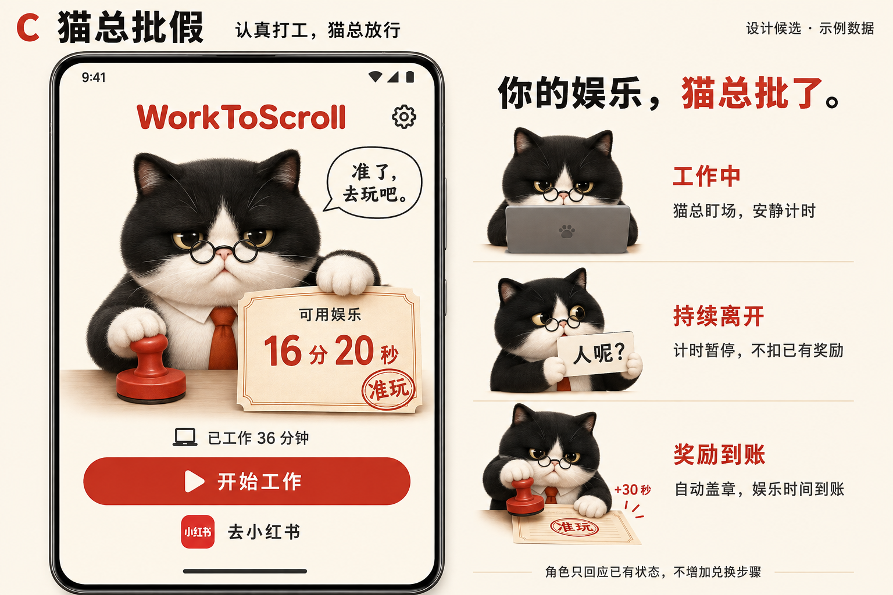
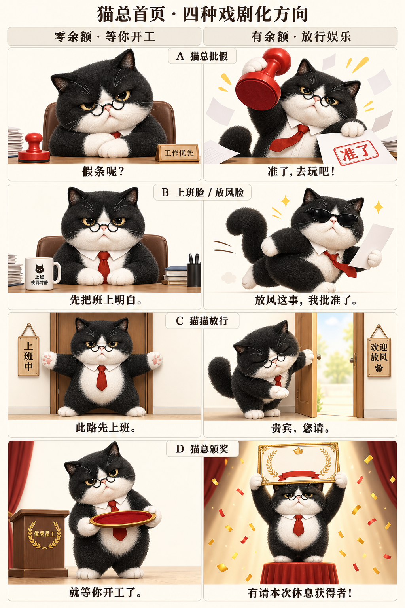

# WorkToScroll — 界面与角色设计

> 设计入口：[DESIGN](../DESIGN.md) · 产品要求：[SPEC](../SPEC.md) · 执行停点：[任务索引](../../tasks/README.md)\
> 依据：2026-09-08 Roy 的界面讨论、A/C 选择、笔记簿修订与角色探索要求。  
> 状态：2026-09-08 Roy 明确授权实施 C「小猫监工」；旧主题 A 保留设计参考。猫总内部的首页双状态已采用[本轮 A「猫总批假」](#cat-home-states)，其余三组存档；带“工作优先／准了”的修正版已接入并安装。0.4.3 旧素材有余额首页已有真机目视证据，0.4.4 修正版的手机显示、零余额及双向切换待核验，见[猫总 UI 任务](../../tasks/active/cat-ui.md)。

## 1. 已明确的设计方向

- 首页简洁、鲜明，让用户一眼理解“工作或学习，获得娱乐时间”，并具有可供截图或短视频展示的视觉记忆点。
- 用图形和时间表达工作与奖励之间的关系，避免把权限、技术说明、测试按钮和兑换规则堆在日常首页。
- 兑换规则在首次进入时用弹窗说明，不常驻首页。
- 当前采用 C「猫总监工」，A「电脑＋笔记簿 / 小红书」保留设计参考；B「镰刀 / 啤酒」不再推进。
- A 的笔记簿应小于电脑，带几行抽象笔迹，一眼像工作或学习笔记。不要可读任务、具体工具主题、复杂清单或整页正文。
- 工作页延续已经确认的黑色背景与有效计时优先；奖励反馈低频、短暂，不干扰工作。

本轮实施授权仅针对 C，不包括 A/C 主题切换。监督角色选择仍属于第 5 节的待探索方向。

## 2. 页面组织与状态边界

下列是当前设计稿的交互整理；C 的本轮具体处理见第 4 节。现有计时、奖励与真实保护状态约束继续适用。

| 页面或场景 | 当前设计表达 | 边界与待细化项 |
| --- | --- | --- |
| 正常首页 | 工作/娱乐图形、已工作时间、可用娱乐时间、开始工作与进入小红书的入口 | 娱乐余额为最突出数字；图中不展示待兑换余量。已工作采用累计有效时间，不冒充今日或当前会话时间 |
| 首次引导 | 兑换规则弹窗，以及首次开始所需的摆位与摄像头说明 | C 已在第 4 节落地首次说明与设置回看；不能静默启动摄像头 |
| 工作中 | 黑底、大号本次有效计时、小型预览与状态、暂停/结束、简短奖励反馈 | 不将“观察到在场”表述为证明正在工作；图稿不替代完整工作页验收 |
| 设置 | 权限、保护开关、使用与隐私说明、明确可见的开发工具入口 | 调试能力保留；不需把完整诊断常驻首页 |
| 未保护或保护失效 | 首页可见原因及处理入口 | 区分手动停止、权限缺失、服务中断；正常首页图中省略状态不授权隐藏真实异常 |
| 零余额 | 明确暂无可用娱乐时间，并引导开始工作 | 图稿展示的是有余额状态；C 的零余额文案和禁用娱乐入口见第 4 节，不得凭空发放额度 |

当前 Android 仅在小红书范围验证；图稿不增加通用 App 选择、PC 联动、云端对话或新的摄像头识别能力。

## 3. A：电脑＋抽象笔迹笔记簿 / 小红书（保留参考）

### 图形与信息

- 紫色笔记本电脑为工作图形主体，右侧搭配较小的橙色线圈笔记簿，组成一个工作/学习入口，不区分两种任务模式。
- 笔记簿仅有四五行抽象笔迹。保留纸页、装订等可识别特征，避免内容抢过图标本身。
- 小红书图标直接表达娱乐时间的使用对象；保留“可用娱乐”和明确时间单位。
- 图形区域是操作入口，配“开始工作”“去小红书”短标签，不再额外堆叠重复按钮。
- 浅紫至暖白背景、珊瑚色品牌与操作提示是当前图稿表达；具体尺寸、触控范围与无障碍可读性需在真实屏幕确认。

### 互动构想

1. 点击电脑/工作区域，进入工作流程。
2. 奖励到账时，以实际到账金额（默认“＋30 秒”）从工作图形移向娱乐图形，表达因果关系；本轮首次达到所选门槛时使用真实到账的“＋5 分钟”，不能照搬示例金额。
3. 点击小红书区域，使用已获得的娱乐时间；实际消费规则沿用现有账本。

图右侧是因果分镜，不是要求退回首页看动画。到账反馈应在当前工作页呈现，具体布局待细化；返回首页不重播历史到账。累计所选门槛时长的里程碑沿用既定低频反馈规则，日常不循环动画。

设计判断：A 的优势是用途与操作直接，风险是视觉更像工具图标组合，独有角色记忆较弱。此为设计判断，未经首次用户理解测试。

## 4. C：猫总监工（当前采用）

### 图形与信息

- 戴眼镜、系领带的严肃猫总构成首页主视觉，用反差建立角色记忆。
- 猫总递出的“准玩”纸张承载可用娱乐时间；下方显示累计已工作时间及两个清楚的操作入口。
- 有可用余额时显示举章猫、“准了，去玩吧！”及“猫总 · 准玩”；零余额显示抱爪猫、“假条呢？”及“猫总等你开工”，娱乐入口不可用，不把测试截图数字带入应用。它们不是新增审批规则。

### 首页双状态：猫总批假（已接入，部分真机验收待完成）

2026-09-08 Roy 查看四组对比图后确认“同意用 A。但其他方案也落盘”，随后要求“请为当前 app 更新 A 方案的图”。本次 A 指猫总内部的双状态方案“猫总批假”，不是第 3 节的电脑＋笔记簿主题；整体仍采用 C「猫总监工」。

| 本轮方案 | 零余额画面与图稿文案 | 有余额画面与图稿文案 | 决定 |
| --- | --- | --- | --- |
| A 猫总批假 | 猫总抱爪前倾，严肃等开工；印章放在桌角，不做盖章动作。「假条呢？」 | 猫总举起夸张的大红章，另一爪递出假条，领带歪斜、纸张飞起。「准了，去玩吧！」 | Roy 已选定采用 |
| B 上班脸／放风脸 | 端坐、领带整齐，旁边咖啡杯。「先把班上明白。」 | 墨镜、松领带，拿着假条急着出门。「放风这事，我批准了。」 | 保留备选，未采用 |
| C 猫猫放行 | 短爪张开挡住小门，严肃但笨拙可爱。「此路先上班。」 | 开门侧身鞠躬，伸爪恭迎。「贵宾，您请。」 | 保留备选，未采用 |
| D 猫总颁奖 | 抱空托盘站在小颁奖台旁，等你开工。「就等你开工了。」 | 聚光灯和彩纸下，高举夸张的大假条。「有请本次休息获得者！」 | 保留备选，未采用 |

采用理由：A 延续现有猫总形象，用“抱爪等待—举章放行”的动作反差纠正零余额也在盖章的图文冲突；“批准几分钟娱乐却像批准重大项目”是戏剧化表达。便于传播是设计假设，尚无分享、理解或长期体验数据。

落地边界：

- 保留同一只黑白猫、眼镜、红领带和暖纸色背景，两个状态保持相近主体比例和位置；零余额不使用放行姿态。
- 图片、文案与娱乐入口共同遵循真实可用余额：零余额等待开工，有余额允许娱乐；不得新增人工批假、手动领奖或额外奖励条件。
- 真实余额继续使用原生文字，不把图稿作为整张首页背景，不把固定时间画进假条。Roy 明确要求保留零余额桌牌“工作优先”和有余额假条上的红章“准了”，这两处文字属于已采用画面的道具细节；不新增单独控件或交互。
- 四方案只存档，不新增主题切换、角色菜单或循环动画。工作页现有盯场、离开和到账形象不随本次选择更改。
- 阻止页另用到期假条形象（2026-09-09 Roy 选定下方 A），与零余额状态含义一致，通过到期假条区分刚刚耗尽的情境；不再沿用旧盖章动作。

资源与来源：[四方案原始对比图](cat-home-state-options-20260908.png)由内置 imagegen 生成，使用旧 `cat_home.png` 作为角色与材质参考；四行两列完整保存，左零余额、右有余额。原始生成文件保留，本目录副本未经裁切或重绘。当前[抱爪等待素材](../../app/src/main/res/drawable-nodpi/cat_home_waiting.png)与[举章放行素材](../../app/src/main/res/drawable-nodpi/cat_home_approved.png)为内置 imagegen 生成的带字修正版，分别保留“工作优先”和“准了”。Roy 在得知重绘神态与原稿仍有差别后明确选择这两张修正版，而非原图裁切；应用资源与[等待审核原图](cat-home-waiting-details-review.png)／[批准审核原图](cat-home-approved-details-review.png)内容一致。首页状态文案与真实余额独立绘制；接入与真机验收见[猫总 UI 任务](../../tasks/active/cat-ui.md)。

最终生成提示词要点：以完整八宫格及 Roy 提供的顶行 A 截图为参考，要求忠实保留原猫的表情、比例、姿态、椅子与道具，约 5:3 独立横图，移除表格边框、行列标题与图外字幕。零余额：半眯眼、低位圆眼镜、抱爪、皮椅，左侧闲置印章与纸堆，右侧桌牌必须清晰写“工作优先”。有余额：抬下巴、举大红章、歪领带、飞纸，右侧假条必须有红色矩形印框和“准了”两字。不写固定余额，无水印；不是像素级原图提取。未用 Python 或其他编辑工具改图，未使用 CLI/API 备用生成路径。

### 状态互动构想

| 触发条件 | 角色表达 | 实际含义 |
| --- | --- | --- |
| 满足现有计时条件 | 猫总安静盯场 | 累计有效时间，不增加额外判断 |
| 持续离开状态成立 | 举牌“人呢？” | 暂停新增时间，不扣已有奖励；不对单帧或每次姿态变化作反应 |
| 奖励成功到账 | 自动盖章“准玩”并轻量提示金额 | 无需手动领取、兑换或请求批准；金额以真实到账为准 |
| 摄像头中断或状态不确定 | 明确解释实际暂停原因 | 不把所有暂停都说成“人走了”；具体角色画面尚未设计 |

图稿的奖励、角色反应是静态分镜。实现通过既有状态切换小图，奖励提交成功后切换盖章形象并轻提示约 2.8 秒；持续离开优先显示“人呢？”，暂停后取消到账表现。角色不引入 AI 对话、意图识别、语音或新增数据收集。工作页保留黑底与计时优先，不照搬首页大角色。

### 本轮页面与素材落地

- 2026-09-09 娱乐规则：设置增加三档兑换比例和默认开启的每日清零开关；首页余额旁显示下一本地 06:00 清零时间，完成清零后下次查看首页轻提示一次。升级保留旧余额，从下一截止点生效；引导、工作页与阻止页读实际比例，不新增必选引导步骤。

- 阻止页同样属于猫总系列：采用 2026-09-09 Roy 选定的 A 到期假条形象、暖纸色和红色圆角按钮；保留“娱乐时间已用完”，配首页已有“先工作，攒点时间。”及本轮实际兑换规则说明。返回工具/桌面动作保持原样，不自动开始工作。临时浮层与全屏页共用布局，不保留“Gate 1 / 手动加入测试余额”的旧提示；不将举牌“人呢？”用于余额耗尽，避免混淆离开状态。

- 首页、设置、开发工具沿用同一 MainActivity 的独立页面实例；系统返回可逐级回到首页。设置中的授权、保护与测试动作保留原有处理路径。
- 当前规则版本首次说明包含每轮门槛、中断重置、兑换规则、固定机位、手动相机与隐私边界；关闭后在独立的 UI 偏好中记住已展示，可从“设置 → 如何使用”重新查看。不写账本或重置授权。
- 正常首页保留一行可点击保护状态，异常以警示色显示；小米后台配置说明保留在设置。核心按钮与图稿信息相同，页面按屏幕宽度与系统边距排布，小屏或大字体允许滚动。
- 工作页显示本轮有效工作与本轮已获得；每轮按 10/15/20 分钟档位先得五分钟，其后每分钟得 30/20/15 秒；当前轮与下轮选择分别显示。连续中断三分钟重置本轮，暂停显示剩余时间和重置说明；已到账余额不因本轮重置倒扣，但遵循每日清零设置；历史累计保留。
- 工作页保留开始/暂停/继续/结束，预览缩至 210×130dp；相机关闭时显示文字占位。按已确认的监测恢复要求，打开说明等临时失焦会暂停，关闭后回到可交互工作页有条件自动恢复；主动返回首页保持停止，重新确认在场前不计时。重复的总余额、待兑换余量及长段说明退出工作主视图。
- 猫总与纸张分开：图片负责角色，原生文字负责真实余额、状态和可访问性，不使用整张概念图作为页面背景。

| 资源 | 用途 | 生成说明 |
| --- | --- | --- |
| [cat_home_waiting.png](../../app/src/main/res/drawable-nodpi/cat_home_waiting.png) | A 首页零余额：抱爪等开工 | Roy 选定带“工作优先”桌牌的独立修正版 |
| [cat_home_approved.png](../../app/src/main/res/drawable-nodpi/cat_home_approved.png) | A 首页有余额：举大章放行 | Roy 选定假条印有“准了”红章的独立修正版 |
| [cat_blocker_expired.png](../../app/src/main/res/drawable-nodpi/cat_blocker_expired.png) | 阻止页到期假条猫，临时浮层与全屏共用 | 2026-09-09 Roy 选定 [A 到期假条](cat-blocker-expired-pass-20260909.png)；[B 到点了](cat-blocker-times-up-20260909.png)保留备选；[生成提示词](cat-blocker-options-20260909-prompts.txt) |
| [cat_home.png](../../app/src/main/res/drawable-nodpi/cat_home.png) | 旧首页猫总和红印章 | 原 C 素材保留，首页与阻止页均已由专用图片接续 |
| [cat_work.png](../../app/src/main/res/drawable-nodpi/cat_work.png) | 工作/等待时的小猫盯场 | 同角色＋电脑，纯黑背景，无时间与状态文字 |
| [cat_away.png](../../app/src/main/res/drawable-nodpi/cat_away.png) | 持续离开时举牌 | 同角色举“人呢？”牌；只绑定已有 AWAY 状态 |
| [cat_reward.png](../../app/src/main/res/drawable-nodpi/cat_reward.png) | 奖励成功到账时盖章 | 同角色压下红章，黑背景，到账金额单独绘制 |

素材全部随 APK 本地打包；首页解码缩采样 2 倍，工作页小图缩采样 4 倍并在页面内缓存，不在每次计时刷新重新解码。首次生成的假透明棋盘格素材未进入应用；最终使用匹配背景或已确认有 alpha 的图片。

设计判断：C 更容易组成“盯场—找人—放行”的短故事，可能有更强记忆点；是否适合长期使用、是否令人反感，以及传播效果，均待验证。

### 设置页分层（2026-09-09 已确认采用）

Roy 指出保护启停与授权混杂、授权重要性不明确，查看可点击提案后明确“同意。实施”。沿用暖纸色、浅色分组容器和红色主操作；仅调整设置及授权详情的呈现和导航，不改变保护算法、授权条件、摄像头或账本规则。

- 设置主页面分为保护卡、保护所需设置摘要、娱乐规则、帮助与说明。保护卡只说明当前状态、实际作用及开启/停止动作；运行时停止为次级按钮，停止时开启为主操作。点击停止先确认后果，取消不写入停止状态。
- 单一“权限与后台保障”入口同时展示必需授权摘要和后台待核对/受限情况，异常不能藏进二级页面；详细授权情况不在保护卡下重复罗列。
- 详情第一组“必需”：使用情况访问用于识别目标应用用时，悬浮窗用于余额耗尽后的阻止界面；每项显示真实授权结果、作用和系统设置入口。缺少时显示“去授权”，已有时显示“查看系统设置”。
- 第二组“重要”：后台运行保障，说明休眠可能导致扣减或阻止失效。Xiaomi 保留本机省电策略“无限制”提示；显示“待核对”或系统能直接报告的“已受限”，不能用打开过设置或当前服务运行推断已配置。
- 第三组“可选”：通知显示保护状态和停止后的开启提醒；不将通知授权升级为开启保护的必要条件。摄像头仍由工作页首次手动开始时单独请求。
- 保护卡区分手动停止、必要权限缺失、服务中断、运行异常、系统后台受限和运行中。缺权限进入权限详情，中断/异常允许请求恢复，后台受限进入后台检查；实际状态由重新读取结果更新，不在点击后假定恢复成功。
- 开启保护遇缺授权时进入详情；返回保留原来的手动停止意愿。停止对话框确认时再次核对当前意愿，防止重复操作反而重新开启。
- 娱乐比例、每日清零和已有帮助/隐私/开发工具入口继续保留。比例详情在选择对话框展示，本轮与所选比例不同时在设置主页面提示下轮生效。监测服务与中断记录等诊断归入开发工具。
- 页面高度随文字增长，保留原生滚动和系统边距；设置与授权详情标题居中，返回逐级退出。主页面不增加新的权限申请或后台状态持久化字段。

实施与验收：[设置页任务](../../tasks/active/settings-redesign.md)。

### 统一视觉语义与场景映射（设计 v2）

**状态与范围：**2026-09-09 Roy 明确认同“印章代表批准，暂停应作用于计时器”，并要求统筹各应用/功能场景的对应关系、统一性与高级感。本节提出整体设计方案；元素职责是已确认纠正，新增具体构图、颜色、台词与动效参数为待审阅建议。覆盖当前 Android 首页、工作页、阻止页、设置/引导及其状态；不扩展到暂缓的 iOS、PC 或新检测能力，也不意味着这一轮全部制作/安装。

#### 1. 统一故事与主语

用户完成工作/学习 → 主计时器记录有效时间 → 达到规则后娱乐时间到账 → 猫总盖章批准假条 → 使用额度 → 假条可用时间耗尽。

猫总是一位严肃、略有冷幽默的监工，代表工具给出反应；奖励来自明确规则，猫总没有自行审批、扣分或撤销余额的权力。用户是工作、获得和使用时间的人；系统故障是工具的问题。角色台词、计时事实与保护状态各自清楚，不能让用户读了文案仍不知道是谁在工作、什么被暂停。

#### 2. 元素只承担固定职责

| 元素 | 固定含义 | 可使用的动作/稳定画面 | 不承担的含义 |
| --- | --- | --- | --- |
| 猫总 | 监督与反馈 | 看向用户、点向计时器、递出假条、奖励时盖章 | 不代表用户；不证明理解用户任务或识破主观偷懒 |
| 主计时器 | 本轮有效工作时间 | 数字累计、暂停标记、恢复、新轮归零 | 不代表娱乐余额、相机是否开启或保护是否运行 |
| 假条 | 当前可用娱乐时间的载体 | 有效、剩余时间变化、用完或到期；固定显示真实余额 | 不代表待兑换工作进度；不增加领取/审批/兑换按钮 |
| 红色印章及“准了”印记 | 已批准获得娱乐时间 | 新奖励到账时盖一次；有效假条保留已获批的静态印记 | 不盖“暂停”“到期”“故障”；不因回首页再次盖章 |
| Ⅱ 状态标记 | 有效计时暂停 | 与主计时器同区域出现/撤去 | 不冒充手动停止监测开关；不装饰成无法点击的按钮 |
| 状态点/小型功能图标 | 摄像头、保护或设置项的真实状态 | 按实际能力显示状态、原因、处理入口 | 不拿猫的姿态证明保护健康；不使用假条/章表示权限授权 |
| 电脑、桌面、眼镜 | 猫总工作环境与角色辨识 | 背景道具，少量使用 | 不作第二个用户状态面板，不暗示已读取电脑内容 |

全系统只维护一个可用余额，假条是它的视觉容器。奖励不是生成一堆独立五分钟券，不新增券包、待领取或不同期限的虚构账本。工作页的本轮奖励是统计信息，与首页可消费余额明确区分。三分钟重置倒计时采用有说明的小字，不做第二个同样醒目的钟。

#### 3. 页面与场景总表

| 页面/场景 | 功能事实 | 推荐画面与动效 | 强度/语义核验 |
| --- | --- | --- | --- |
| 首次引导 | 解释工作换娱乐及必要设置 | 简单静态顺序：计时器 → 已批准假条 → 使用娱乐时间；真实操作使用现有入口 | 轻；不以演示盖章冒充真实到账，不自动开相机 |
| 首页：零余额，尚未获得 | 当前无可消费时间 | 猫总等待；同一假条位置显示“暂无可用娱乐时间”和 0，可用娱乐入口按原规则不可用 | 静态；不显示“已用完”或“到期”，不盖章 |
| 首页：有余额 | 已有真实可用时间 | 猫总展示带静态“准了”印记的有效假条，真实余额为主数字；章放下 | 静态；表现已有授权，不表演刚刚新批准 |
| 开始监测/确认在场 | 用户已请求启动，计时条件尚未成立 | 主计时器就位；猫总看向用户；明示“正在确认在场 · 尚未计时” | 轻；不提前走时、点亮累计状态或批准奖励 |
| 正常有效工作 | 正在累计有效时间 | 猫总安静盯场，主计时器持续更新；事实状态“正在累计” | 静态为主；无常驻口号、无循环猫动作 |
| 短暂未见，容错中 | 还未确认持续离开 | 维持正常构图，状态行说明短暂容错 | 轻；不提前问“人呢？”或按停数字 |
| 已确认持续离开 | 暂停新增有效时间，仍继续检测 | 猫总抬眼；暖白粗体“人呢？”斜切；猫爪指向/按住主计时器边缘，Ⅱ 标记落定；真实数字冻结 | 强事件、短时；作用于计时器，不出现印章、假条变化或处罚画面 |
| 离开后重新确认/回归 | 确认期间不计时；成功后恢复累计 | 确认时撤去追问台词但保留Ⅱ；确认成功后猫爪离开计时器，Ⅱ 消失，短句“回来了？继续。”后归于安静 | 中等；动画不拖延计时，不额外模拟“点击继续” |
| 用户主动暂停 | 用户主动停止监测 | 同一主计时器暂停，猫总安静，文字“你已暂停监测” | 轻；没有“人呢？”或指责，不与自动暂停混为同一种意愿 |
| 连续中断满三分钟 | 本轮进度重置，已有奖励不倒扣 | 只有主计时器和本轮进度变零；显示“本轮已重置，已到账奖励保留” | 轻；假条不撕毁、不收回、不退色；余额到期若恰好同时发生另说明原因 |
| 首次奖励到账 | 本轮达到门槛，实际新增五分钟娱乐时间 | 工作页局部奖励区中，猫总在假条上盖“准了”；实际 +5 分钟落在其金额区域；主计时器继续 | 中等、约 1—1.5 秒；局部、不响铃、不弹窗、不要求领取，不能抢成全屏庆祝 |
| 后续分钟奖励 | 实际新增 30/20/15 秒等账本差额 | 同一局部假条/奖励位置轻量出现新增金额再淡出；不再大盖章 | 轻；每次增加都是已获准的奖励，盖章语义不要求所有到账都表演盖章 |
| 工作里程碑 | 工作达到既定里程碑，可能同刻有奖励 | 原位置显示实际工作成果；已有奖励并入一条信息 | 轻；里程碑本身不多发一张假条，不多盖一章，不叠两条庆祝 |
| 主动结束工作 | 结束本轮，已有奖励保留 | 停止工作态，按现有返回/结束流程呈现；如以后有成果页，用计时与奖励汇总 | 轻；不新增结束后“再审批一次”的流程，本轮不开发新结算页 |
| 使用小红书 | 按实际使用消费余额 | 保持原 App 使用；返回本工具时，假条显示真实剩余时间 | 不增加遮挡小红书的猫、假条或倒计时浮层，不模拟持续消费 |
| 实际消费耗尽后阻止 | 余额用完，需要先重新获得时间 | 阻止先立即生效；明确新耗尽事件触发大字“时间到了！”与猫总直视，娱乐余额 00:00、事实说明及返回操作持续可用；随后进入稳定零余额态，详见[皮肤草案](skin-system-proposal.md) | 强且仅一次；不延迟阻止，不用印章表示耗尽，不暗示删除工作历史；具体节奏待样片验证 |
| 每日到期清零 | 按用户设置结算到期余额 | 下次进入时同一假条失效/退色，轻提示“已按设置清零剩余娱乐时间”，注明当前额度状态 | 轻；不能说“你已经用完”，不演被抓包、不催使用 |
| 再次进入零余额阻止页 | 当前没有可用时间，未必有新耗尽事件 | 直接还原静态零余额假条；只有可靠原因才写用完/到期，否则“暂无可用娱乐时间” | 静态；不能每打开一次重新收条。该文案调整是方案，现有文案仍待统一实施 |
| 多人/弱信号/相机中断 | 无法确认在场，不等于人已离开 | 中性猫；主计时器Ⅱ；在预览/状态区域用琥珀提示实际原因和已有处理入口 | 轻；没有“人呢？”，不修改娱乐假条 |
| 保护停止、异常或缺权限 | 娱乐限制可能没有实际运行 | 首页小型保护区与设置详情显示原因和动作入口；与监测/计时分开 | 轻但持续可见；不盖批准章，不靠锁图标或猫抱臂假装已拦截 |
| 权限/比例/清零设置变更 | 用户修改规则或系统权限 | 原生选择、状态反馈和准确生效时间 | 轻；设置成功不用猫总审批。授权成功与保护运行分别确认 |
| 帮助/隐私/开发工具 | 解释规则、隐私或查看诊断 | 清楚的文字、真实功能图标和既有返回层级 | 静态；不把角色表演塞入系统排障或技术信息 |

“把假条推到一旁”只是一种状态过渡，不新增可点击的历史收纳区。历史记录保留由原有数据规则保证，不能从动画中虚构新功能。没有可靠耗尽原因事件时只显示静态状态，不靠 0 余额猜故事。

#### 4. 统一性与高级感的具体约束

本方案对高级感的判断是：含义准确、物件一致、层级稳定、运动克制且触点可信；这些需要合成样片与真机检查，不是加金属光泽就自动成立。

- **主视觉只分两种工作环境。** 工作页保留黑底，突出计时与短时角色动作；首页/阻止页保留暖纸色，突出同一张娱乐假条。两者使用同一猫、同一字体系、同一假条轮廓和章形，不把每种异常做成一个新主题。
- **角色一致。** 同一毛色、脸型、眼镜、光向、观察角度与尺度；眼神和爪动作变化即可，不临时换制服、武器、赛博头盔或新职业。工作电脑作为背景，不抢计时器的功能位置。
- **每种东西只用一种造型。** 工作时间是主计时器；余额是纸质假条；印章是朱红色实体章及相同的“准了”印记。不额外加入金币、钻石、保险箱、奖杯、锁链、通行门等并列比喻。应用沙漏图标可保留作为品牌标识，不再添一只流沙沙漏与主计时器同时走时。
- **颜色固定职责。** 建议工作页以黑/暖白为主，朱红仅作为叙事中的批准印章强调；离开靠暖白大字、冻结和构图收紧形成冲击，不用同一种红色既庆祝批准又表示暂停。设备不确定/故障用琥珀，稳定运行仅用小型低饱和绿点。不得仅凭颜色区分状态。现有红色按钮如何统一属于后续整体视觉制作，不在本轮直接改 App。
- **先有动作目标，再有运动。** 计时变化发生在计时器，奖励变化发生在假条，保护问题发生在保护区。猫爪触点须落到对象上，落章应落在纸面，不能隔空操作或只震整个页面。
- **布局不追着表演跳。** 主计时器、余额、状态行和操作区位置固定；角色与台词在预留空间中运动。猫爪临时覆盖只能接触计时器边缘，不能遮掉数字或按钮。显示型Ⅱ标记不是伪按钮；真实暂停/继续按钮继续执行原功能。
- **动效统一节奏。** 主要动作进入约 180—350ms，稳住约 600—900ms，退场约 250—400ms；离开一幕整体控制约 1.3—1.7 秒，实际值经样片再定。回归像同一动作被解除，不播放一套不相干的绿色庆祝。只有章的物理接触允许很小的一次回弹，其余不做橡皮缩放。
- **文案分层。** 猫总台词短、有角色署名；事实说明直接准确；系统故障不说俏皮话掩盖问题。不把不同页面都做成“大英文＋中文解释”；英文不是高级感的必要条件。
- **奖励不抢工作。** 第一笔奖励局部盖一次章，后续金额更新轻量；不改已确认的安静奖励边界。持续工作画面不循环动，声音开关仍保持原有规则，不因新的视觉故事新增台词语音。
- **静态也成立。** 关闭动画、重新进页面或停在任何稳定态时，靠物件状态与文字就能看懂；不需要记得上一幕才能理解当前是否计时、是否有余额、是否在保护。

#### 5. 当前画面需要怎样调整

| 当前内容 | 结论 | 建议处理 |
| --- | --- | --- |
| 离开时盖“暂停计时”红章的样片 | 与已确认的印章含义冲突 | 停用，保留原文件用于追溯；不进入 App。保留抬眼/短台词的节奏，重新制作猫爪与主计时器动作 |
| 旧详细设计里的盖章/撤章暂停流程 | 已被新语义推翻 | 标记为停用历史稿；1 秒回归确认、3 秒容错等真实规则仍由 SPEC/代码维护，不能照搬旧表演 |
| 首页有余额时猫总举章、已经有“准了” | “已获批”的语义成立，但容易像每次进首页都在新批准 | 静态已盖章假条可保留；新稿优先改为展示已批假条、章放下。不对已有静态素材谎称已存在重播问题 |
| 阻止页的“到期”红章假条 | 与新统一语义及“用完/到期”的区别冲突 | 新稿移除到期红章，按真实原因用文字区分；已装素材先保留，批量替换须按新稿接入 |
| 正常工作使用猫总身份当状态 | 主语错误 | 状态只写正在累计等事实；猫总为署名/角色，沿用此前纠正 |
| 旧每分钟奖励淡出 | 与安静工作原则一致 | 保留，并让金额位置与假条/奖励区一致，无需为了升级全部重做 |
| 首页与设置真实保护区 | 需要独立表达，不能被角色系统吞掉 | 保留信息和入口，只统一字体/间距/小图标，不戏剧化系统排障 |

#### 6. 审阅与制作顺序

先审阅本表的场景对应与视觉语义，再做同一张对照稿中的五个关键稳定态：正常工作、离开暂停、奖励已批、有余额首页、零余额阻止。它们用于检验同一套物件是否真的一致，不等于同时制作五段动画。

随后仍只重做“离开 → 计时器暂停”这一幕样片。该段通过后再扩展奖励批准与假条失效；保持用户“先做一个看效果”的制作边界。暂不改已安装 App、不删除旧资产、不引入新功能。

每个画面/动效按下列问题审阅：

1. 不看上一幕，能否知道谁在工作、何种时间变化、是否还能娱乐？
2. 去掉文字后，道具是否仍指向正确对象；加回文字后，是否明确用完、到期、未获得及工具故障？
3. 同一个章/假条/计时器换场景后是否仍是同一含义、造型与数字来源？
4. 动画停在任意帧是否会误示已经恢复、已经到账或已经保护；是否遮挡操作或延迟真实状态？
5. 黑白查看、字体放大、系统关闭动画后仍可读吗；是否能看到角色触点，是否存在明显拼图/漂浮感？
6. 目标用户能否用自己的话说出想分享哪个具体动作；“好看”但说不清功能、误认为扣罚或设备出错，均应先改语义而非加特效。

上述为待验证的设计标准，不声称已达到高级感或传播效果。实施后的功能证据与用户的审美/干扰反馈分别记录。

### 猫总「时间到了！」单幕 v1（2026-09-09，Roy 已认可视觉方案）

Roy 要求按新确定的预制角色与共用反馈原则继续猫总版动效设计。本次仅制作真实消费耗尽的一幕；Roy 查看后回复“同意”，确认采用此视觉与节奏作为猫总耗尽场景的设计基线。Roy 随后要求修改，0.5.4 已将这一幕接入 App；不同时扩展所有场景，当前验证见任务现场。

- **角色层：**同一黑白猫总、低位圆眼镜、红领带、抱爪直视；采用一张无印章、无桌牌的半身图，不用批准道具表示叫停。[原始形象](cat-time-up-portrait-v1.png)及[预览编码版](cat-time-up-portrait-v1.webp)。本稿仅整图缩放，没有生成连续抬眼或手部动画。
- **共用动效层：**0—190ms，角色从原尺寸拉近到 1.075 倍，红色“时间到了！”由下方 35px 切入、从 1.18 倍收至原尺寸，底线展开；190—1100ms 定住；1100—1550ms 角色退回原尺寸，标题收至 0.83 倍、底线撤去。上述参数记录获认可样片的默认节奏；落地时仍须按真机尺寸与性能核验，不将浏览器像素直接当成 Android 尺寸。
- **事实层：**“可用娱乐时间 00:00”“娱乐时间已用完”与返回操作始终可见，字效不驱动余额。阻止在事件发生时立即生效，不等动画结束。预览余额为模拟，并没有实际拦截手机或改变账本。
- **构图：**沿用猫总首页/阻止页的暖纸色、黑白角色与红色重点；角色直视为上半部焦点，标题在角色胸前，余额在独立区域。镜头只动角色，不放大或挪动按钮。
- **重播与退场：**正式产品仅可靠的新耗尽事件播放一次，重复进入恢复静态。样片另外提供重播、冲击定格与稳定画面，便于审阅；这些不是产品按钮。减少动态效果时直接显示静态反馈，当前不加新声音或震动。

会话预览：`C:\Users\11300\.codex\visualizations\2026\09\09\01a084ab-0a5c-7590-b892-979f237904f0\cat-time-up-v1.html`。Roy 已认可此样片；0.5.4 已据此接入，下一步接续真机动效与实际消费验收，不自动增加连续表情或手部素材。此样片不取代全部 v2 场景方案。

### 旧稿：离开与回归盖章分镜（已停用）

> 本节整体已被[统一视觉语义与场景映射](#visual-language)替代。Roy 确认印章只表达批准，以下暂停章、撤章流程及其猫图需求不再采用；保留文本用于追溯，不能作为实施清单。日期与“已同意”的描述仅代表当时阶段。

**版本：2026-09-09 / 详细设计 v1。** Roy 已同意“黑色幽默、电影感、干脆利落”的方向，授权先将“离开 → 人呢？ → 暂停 → 回归”细化。以下布局、动作参数与素材拆分是本轮建议默认值，尚未实施或通过真实用户验证。本节为该段设计的唯一维护位置；执行状态见[状态反馈任务](../../tasks/active/state-feedback-design.md)。此前会话中大英文标题的文字动效预览是已被替代的早期探索，不代表本方案。

单幕候选素材：[离开三帧](cat-away-sample-20260909.png)。按 Roy“先选其中一个看效果”的要求，先用这一组评估抬眼/落章的视觉与节奏；候选不等于已选定生产素材，完整分层、回归及其他事件仍未完成。样片和验证范围由任务维护。

#### 1. 要让用户记住什么

目标记忆是“我给自己雇了个猫老板，它真的管着我的刷手机时间”。角色严肃，动作有因果，用户能一眼看懂实际状态，并愿意展示这段反差。此表述是设计意图，不进入 UI 当宣传承诺。

- 角色、台词、暂停结果构成一个动作：猫总抬眼 → 问“人呢？” → 按下暂停章。撤章与恢复形成呼应。
- 常态安静，事件的主动作在半秒内完成；停顿让人看清，退场让人继续工作。强效果集中出现，不用常驻扫描线、乱跳代码或粒子填满屏幕。
- 面向 SPEC 定义的目标用户，优先精致排版、冷幽默、可截取的构图与角色辨识；这些是否有吸引力是设计假设，不从性别、城市或消费层次推定审美。
- 本段升级仅作用于工作页的猫总/状态表现。首页、阻止页、奖励反馈、声音与保护流程沿用现状；未来盖“准了/到期”的动作可复用本次语言，但本轮不实施。

#### 2. 信息主语与完整文案

监工身份在页头“猫总监工”表达。**状态区只描述计时/检测结果；猫总的台词单独放在角色舞台内，并用小号“猫总”署名。** 用户不被称为猫总。不让英文标题承担事实解释。

| 场景 | 猫总台词/舞台 | 真实状态区 | 计时与补充信息 |
| --- | --- | --- | --- |
| 稳定在场 | 安静盯场，无常驻口号 | 正在累计；辅助“观察到在场” | 原位置显示本轮有效工作，奖励/比例沿用现有值 |
| 短暂未见，尚在容错 | 维持盯场，不提前抬眼或盖章 | 暂未见人物 · 短暂容错中 | 计时显示沿用实际规则，不人为冻结 |
| 在场后的持续离开已确认 | “人呢？”；印章“暂停计时” | 持续未见人物 · 计时暂停 | 原计时停在账本真实值；另行显示距本轮重置的剩余时间 |
| 离开持续 | 抬眼等待；紧凑“人呢？”和小暂停章 | 同上，持续可读 | “距本轮重置 02:58”等实际倒计时，不循环喊话 |
| 重新看到人，仍在确认 | 收起“人呢？”台词，保留暂停章；不播放回归表演 | 正在确认在场 · 尚未计时 | 进度保持实际值，重置倒计时按真实中断起点继续 |
| 离开后确认回归 | “回来了？继续。”，猫总撤章 | 正在累计；辅助“观察到在场” | 不等动画结束才累计；数字在下一次实际计时更新时变化，不补计确认期 |
| 中断期间本轮已重置后回归 | 同一回归台词，不另演新剧情 | 正在累计 | 辅助“本轮已重置，重新累计”；不声称续接旧进度 |
| 初次开启未见人 | 中性盯场，无“人呢？”大字 | 尚未看到人物 · 尚未计时 | 不能演成用户刚刚离开 |
| 多人、弱信号、相机异常 | 中性角色，取消正在进行的离开/回归动作 | 使用实际原因及原有处理入口 | 不套用“人呢？”；暂停不等于确定离开 |
| 用户主动暂停 | 中性角色，不追问、不盖警告章 | 你已暂停监测 | 保留现有继续、结束与重置规则 |

离开舞台可保留 11—12sp 的 `AWAY DETECTED` 为次要视觉标签；正常状态不常驻巨大 FOCUS，回归不常驻巨大 BACK。中文角色台词是第一记忆点，实际状态不会因台词更换消失。台词仅显示，本轮不新增对应语音。

#### 3. 竖屏布局与视觉规格

工作页仍为黑底。按**可用内容区域 360×780dp**推演布局，系统状态栏、手势区与安全边距另计；它不是锁定屏幕尺寸的要求。

| 从上到下 | 推荐空间与职责 |
| --- | --- |
| 页头 | 48dp，保留返回、猫总监工、说明 |
| 固定角色舞台 | 156dp，左右各 16dp；猫总在左侧约 100×132dp，右侧约 208dp 呈现台词与印章。正常时留白，不另塞说明 |
| 本轮有效工作 | 100dp，标签 16sp，数字上限 62sp；全程原地，数字不做碎裂、滚轮或缩放 |
| 真实状态与重置信息 | 66dp 起，主要状态 16sp，次要说明 14sp；允许随字体放大增高 |
| 本轮奖励与兑换说明 | 54dp 起，原有信息；既有奖励反馈使用预留区域，不插入新一行挤动计时 |
| 摄像头预览 | 保留现有 210×130dp、完整画面比例和关闭占位 |
| 操作 | 暂停/继续与结束同排，目标高度至少 48dp；间隔后为原提示音开关，再保留恢复规则短说明 |

常规布局的空隙约 40—60dp。尺寸预算用于发现挤压，最终以实际控件测量为准。正常与离开使用同一舞台高度，不因大字入场推移下方信息；不新增悬浮模态层覆盖按钮或预览。装饰边线在内容内侧约 8dp，不覆盖系统状态栏或伪装系统警告。

- 底色建议 `#101412`，主文 `#F3F0E8`，辅助文 `#BAC6BE`；事件红 `#FF655F`，恢复点缀 `#A5DFC2`，不确定状态沿用琥珀色 `#E6C787`。
- “人呢？”使用系统无衬线粗体约 52sp；倾斜由整体图层旋转约 -6°实现。原计时保持 62sp，颜色为暖白。两者靠空间分区和短时入场区分，常态只突出计时。
- “暂停计时”章为暗底红字红框，不用红底小白字；建议正文 20sp、框约 136×44dp、旋转 -5°。字必须由原生文字绘制，不能烘焙进猫图。
- 回归台词约 26sp，最多两行；恢复点缀只用于短划线/小状态标记，不让整屏变绿。中文清楚优先于装饰英文。
- 320dp 宽时舞台左右约 88/184dp，“人呢？”可降至 44sp。系统字体放大时允许台词分行与舞台增长；先移除装饰英文、缩小角色，再允许页面滚动，不缩小必要正文以硬塞。
- 横屏或可用高度不足时，优先复用现有滚动页面与紧凑舞台，主动作仍能看清，计时和操作可达；不为本段引入整页双栏重排。系统关闭动画时仍显示同一套文字与静态姿态。

#### 4. 离开分镜：总时长 1.65 秒

**t=0 是计时系统已确认持续离开并进入暂停的时刻，不是人起身的第一帧。** 当前在场后连续未见人的容错为 3 秒；表现层不能另设计时阈值。

| 相对 t=0 | 猫总动作 | 字与场景 | 实际信息 |
| --- | --- | --- | --- |
| 0—120ms | 头由低眼盯场切到抬眼姿态，微抬约 3dp；身体固定 | 内侧四角短线向内收约 8dp并变红；一次收紧后停住，不震整屏 | 暂停事实立即出现，计时使用实际值 |
| 100—240ms | 抬眼定住，严肃看向前方 | “人呢？”从右上偏移 24dp/-10dp 斜切至位，缩放 108%→100%，终态 -6° | 小号事实说明持续可见 |
| 220—400ms | 前爪带章下降约 18dp，落点与文字章位置一致 | “暂停计时”在约 320ms 接触帧出现，118%→97%→100%；仅章自身做一次约 2dp 的落定反弹 | 不延后暂停、不加扣费 |
| 400—1250ms | 停在按章/抬眼姿态 | 大字、猫总、印章都静止，留一个清晰可截图构图 | 真实重置倒计时正常更新 |
| 1250—1650ms | 前爪收回，保留抬眼等待 | 台词降至约 24sp等效尺寸，章降至约 90×30dp，收至舞台右侧固定位置；角线退为低强调 | 暂停原因和剩余时间持续显示 |
| 1650ms 以后 | 静态等待 | 不复读、不巡逻、不呼吸闪烁 | 直至检测结果或用户操作变化 |

运动调性：文字快速进入、减速停稳；落章只反弹一次，幅度小；收场缓和但不拖延。建议位移采用 ease-out；印章使用明确关键帧，避免橡皮玩具式连续弹跳。瞬时红色区域限定于字、章与短边线，禁止全屏红白交替闪烁。

#### 5. 回归分镜：总时长 1.1 秒

**r=0 是新的在场确认成功。** 当前回归需新鲜结果连续确认约 1 秒；这段时间不能出现“继续累计”。

| 相对 r=0 | 表现与因果 |
| --- | --- |
| 0ms | 真实状态立即改为“正在累计”，取消旧红色动作及其回调；计时系统继续处理真实有效时间 |
| 0—180ms | 猫爪向右上撤，暂停章同方向平移约 24dp并淡出；没有章的页面恢复不凭空造一个章再撤 |
| 150—330ms | “回来了？继续。”在角色署名下短移入约 12dp；猫总回到低眼盯场，短绿色划线出现 |
| 330—800ms | 台词停留，计时与状态持续可见；不暂停页面交互等待欢迎完成 |
| 800—1100ms | 台词移开并淡出，绿色划线收起；回到无常驻口号的安静工作页 |

若离开表演未播完用户就回来，最新真实状态优先。进入 CHECKING 时立即去掉“人呢？”而保留暂停事实；一旦确认成功，直接执行撤章/回归的有效剩余动作，不补播没完成的抬眼或盖章。若确认期间再次未见人，恢复静态离开态，不把同一次离开重复演成新事件。

#### 6. 猫总素材制作要求

保留当前猫总的毛色、眼镜、领带、脸型和严肃比例。仅制作工作页所需的动作部件，不改首页已确认的“批假”双状态与阻止页“到期假条”。不通过放大整张静态猫图代替抬眼或盖章。

建议交付五张配准的透明 PNG：身体/桌面基础层 1 张；头部低眼、抬眼 2 张；前爪休息、按章 2 张。它们共用 512×640px 画布、相同身体锚点与透明边距；头与手的接缝藏在衣领/袖口，不露出重复轮廓。头和前爪局部切换辅以极短位移，身体不整体弹跳。

- 层次从后到前：身体/桌面 → 头 → 台词及纸面印记 → 前爪/实体章；按压时手不能在文字背后穿过。必要时将实体章与前爪放在同一部件内，接触点预先对齐。
- 文字、框线、真实时间全部由 UI 绘制；素材里不写“人呢？”、“暂停计时”或金额，便于字体缩放和无障碍读取。
- 制作顺序：先用当前猫总为参考做“盯场/抬眼/按章”三姿态同页对照，确认同一角色后再拆层，最后校准接触帧。不要先生成一段不可控的完整视频当应用动画。
- 交付同时提供正常、入场最大状态、暂停稳定态、回归四张组合参考帧；这些参考帧仅供视觉比对，不能作为整屏图片直接上线。
- 五张部件按显示尺寸解码一次并复用；不逐帧解码，不随计时刷新加载，不新增常驻视频或网络资源。当前旧猫图保留可回退，拆层素材尚未生成。

#### 7. 真实状态与表演事件的关系

表现层读取现有 WorkClock、WorkProgress 与 CameraRecovery 的结果。它只决定“播哪段/还原哪张静态画面”，不修改账本、观察结果、奖励、恢复重试或中断起点。

| 输入路径 | 表现决策 |
| --- | --- |
| 本次连续可交互监测中已出现 PRESENT，随后经 GRACE 进入 AWAY | 新离开事件，可播放一次完整入场 |
| GRACE 内直接回 PRESENT | 正常继续，无“人呢？”、盖章或回归表演 |
| 初始 AWAY，或 UNCERTAIN/相机中断后首个结果为 AWAY | 静态说明尚未见人；没有充分离开事件证据，不播放完整入场 |
| 已有离开事件 → CHECKING → PRESENT | 回归事件；若期间本轮重置，回归表演相同，进度说明依真实账本变化 |
| CHECKING 又回 AWAY | 同一次离开，回静态暂停态，无新章 |
| AWAY → UNCERTAIN、相机失效、失焦、手动暂停或结束 | 立即中止动作并呈现真实原因；结束本次可表演的离开事件 |
| 重新打开工作页、旋转重建、解锁恢复或进程恢复 | 从真实状态还原静态界面，不补播历史离开/回归；后续新的完整离开链才可表演 |
| 回归动画期间再进入 GRACE/AWAY | 按新状态立即切换；不留“继续”台词覆盖暂停，是否完整入场仍遵守冷却 |

去重建议：每个离开事件只播一次；两次完整离开入场起点至少间隔 10 秒。冷却内仍立即显示抬眼、小“人呢？”、暂停章及真实暂停，但不弹大字；对应回归也使用紧凑恢复提示，避免抖动时反复欢迎。冷却只控制动作，不控制检测/计时/声音。冷却时间用单调时钟，在同一工作页监测上下文保存；失焦取消动作，页面回来静态还原，不能靠重开获得额外表演。

同一时刻的显示顺序：用户停止/离开页面 → 恢复故障或状态不确定 → 本轮真实重置 → 当前在场状态 → 庆祝。中断满三分钟时取消大“人呢？”表演，静态说明“本轮已重置 · 已到账奖励保留”；回归后再显示新一轮。已有奖励照常入账，重叠时取消其视觉庆祝且不排队补播，不更改奖励事实。

建议实现为工作页内一个事件呈现控制器，不新建独立服务。每次状态/生命周期改变递增本地动画代次，旧完成回调核对代次后才可改 UI；隐藏或重建时清理动画与延迟回调。与现有相机 generation 分开命名，防止误认为视觉取消等于停止采集。此为计划实现，尚不是实际架构。

#### 8. 声音、可访问性与性能

- 保持现有“欢迎归来”“滴～暂时离开”提示音、媒体音量、开关及首次结果逻辑；声音来自初步检测，可能先于计时确认和视觉演出。本轮不新增警笛、落章声、语音台词或震动。
- 即使声音关闭，猫总动作＋中文暂停状态＋冻结的真实计时仍完整解释事件。不为宣传剪辑伪造同一时点触发。
- 系统关闭动画时不执行缩放、位移、边线收紧；直接显示紧凑静态“人呢？”与暂停章，确认回归后直接回正常。仍保留全部信息及操作，无需额外新设“酷炫模式”。
- 屏幕阅读器播报事实状态变化一次；不逐帧播报，不每秒朗读重置倒计时。猫图和装饰英文不重复进入朗读。重置发生时单独报告“本轮已重置，已到账奖励保留”。
- 入场阶段不得禁用暂停/结束或抢走触摸焦点，不因动画改变摄像头权限、采集频率和亮屏策略。
- 静态期无额外动画定时器；动作结束停止重绘，短片以位移/透明度为主。现有预览为 PERFORMANCE，装饰留在预览区域之外，避免为叠加特效改相机渲染路径。

#### 9. 验收与“酷”的判断

以下为本段建议验收方法与阈值，尚未执行；不能把技术通过写成目标用户认可。

| 检查 | 通过条件/失败信号 |
| --- | --- |
| 因果与主语 | 看约 3 秒的静音离开片段，5 名目标用户至少 4 人能说清“猫是监工，我离开导致计时暂停”；把猫当计时对象、误认为 App 崩溃为失败 |
| 角色记忆 | 观看后能主动描述“猫抬眼问人呢并盖暂停章”，而不只记住红光/英文；记录原话，不用引导性提问替代结果 |
| 自愿展示 | 不先说“酷不酷”，询问“你会把哪一段发给谁，配什么话？”；愿意主动重播/选择发送片段比口头说好看更有参考价值。小样本信号仅用于改稿，不当增长证明，不实际代用户发送 |
| 日常干扰 | 30 分钟正常工作、姿势调整和一次真实离开：容错内不弹大字，同次离开不重复；反复想关掉、感到被责骂或打断思考应调整 |
| 快速反转 | 离开动作任意阶段进入确认/回归/故障/手动暂停，下一次 UI 更新即显示最新事实，无旧章或旧回调覆盖 |
| 数据一致 | 3 秒容错、1 秒确认、3 分钟重置沿用实际规则；无动画产生的额外有效时间、倒扣或奖励，重开不重播 |
| 可读与可用 | 真机 320/360/常用宽度、横屏、字体放大和系统关闭动画下检查；中文、计时和按钮不裁切、不重叠，静态模式也能懂 |
| 动作质感 | 猫头/爪动作自然，章落点对齐，无图层穿插、透明边闪跳、整猫橡皮缩放；事件动画无连续明显卡顿，正常态无循环动画 |
| 负载 | 同机同相机/亮度条件比较关闭/启用表现的静态期，确认没有常驻动画任务或新增相机负载；温升、耗电若要作承诺必须另作真实对照 |

宣传素材先做一条完整的约 10—12 秒场景：约 1.5 秒稳定计时 → 真实离开及容错 → 约 1.65 秒离开表演 → 人回到机位并经过在场确认 → 约 1.1 秒回归动作。总时长取决于人实际动作和检测，不用固定镜头长度倒逼判断时点。等待若剪短须说明经过容错。合成预览标“模拟状态”，真实宣传录制需另行安排，不保存或上传连续相机画面。

#### 10. 制作与交付顺序

1. 完成三姿态同页稿及四张关键组合帧，先检查角色一致、主语和视觉焦点。
2. 用合成状态做本段动作样片，验证落章/撤章因果、节奏、快速反转和静音理解；旧大英文预览不能代替此步。
3. 在素材与样片审阅后接入真实工作页，限于视觉呈现与取消/去重；保持检测、账本和恢复机制。
4. 完成相关状态/去重验证、构建和真机验收，再进行日常体验观察。确认这段成立后，才细化首次奖励和耗尽的同系列动作。

本轮交付为详细设计文本；素材、样片和 App 接入均尚未完成，也不把已同意方向解释为所有新增参数都已经接受。

## 5. 用户选择监督角色：已确认方向与待探索细节

2026-09-09 Roy 要求统筹未来售卖预制皮肤、照片定制、AI 后台与卡通/真人表现，新增[预制角色皮肤顶层规划草案](skin-system-proposal.md)。Roy 已确认预制成品预览和使用、AI 素材由制作端负责挑选与返修、共用字效/节奏/功能信息，上传照片生成角色移出近期路线；确认边界见 [SPEC §11.2](../SPEC.md#112-预制角色体验方向2026-09-09roy-确认尚未实现)。真实消费耗尽加强为一次“时间到了！”的具体表现仍待样片检验。通用功能反馈与角色包分离；上方猫总 v2 是猫总主题内的语义方案，不能未经决策将爪子、假条和印章强制推广到所有角色。顶层交付与复用方向已确认；具体角色与视觉细节待设计，不逐个重做整套动作。

**创意来源与状态**：Roy 提出“增加用户选择功能”，让用户选择经典、有威严或带吓唬人气质的监督角色，并明确要求先列为待探索。上述创意是此前探索来源；本次仅将明确同意的交付与复用方向转为已确认，参考人物并未因此获选，不新增当前实现任务或默认角色。

用户原始参考包括：

- 盖世太保。
- 锦衣卫（张震）。
- 吃人博士。
- 曾国藩。
- 孔子。

以上保留为参考标签，具体人物、影视形象、画风和台词没有定稿；“吃人博士”的具体指代不自行补成某一角色。猫总是已有 C 方案，可作为讨论角色化体验的基线。

### 可探索的体验

用户选择喜欢的监督者，同一套工作、离开、奖励状态由不同角色通过表情、动作或短文案表达。角色可以有不同气质，例如威严、冷幽默、严师；这些分类只是设计建议，并未成为已确认菜单。

### 后续需要判断的问题

- 角色选择与 A/C 的关系：普通界面加角色皮肤、独立主题，还是仅工作页出现角色？尚未确定。
- 角色的造型、素材来源与使用方式、台词、是否有声音及提醒强度怎样确定？当前不开始收集或生成这些素材。
- 如何让角色有反差和记忆点，又不让真实工作变成持续被打断或被训斥？是否允许切回普通界面、调节表现强度？
- 如何仅用已有可观察状态驱动反应，而不让角色声称读懂用户思想、工作内容或意图？
- 用户愿意持续使用，还是只觉得一次演示有趣？不能用播放量代替长期使用验证。

探索指标可采用首次观看后能否说清用途与下一步、是否记住角色和奖励关系、是否愿意分享，以及实际使用中的干扰与反感反馈。具体阈值待验证设计，当前不承诺传播效果。

## 6. 参考与保留材料

- Roy 提供的 RizzGPT 截图：参考的是极简信息量与明确操作，不引入其产品功能；本地临时附件不是长期依赖。
- [凛冬督学局 AI 军官督学视频](https://www.bilibili.com/video/BV1qAub6KEkJ/)：可能对应 Roy 提到的案例。本轮只核对公开标题与简介，未逐帧分析完整视频；“角色＋状态反应”的价值属于设计推断。
- [A v3 来源图](ui-candidate-a-laptop-notebook-v3-20260908.png)、[C 来源图](ui-candidate-c-cat-supervisor-20260908.png)：与本目录当前两张图对应，原图保留。
- 历史探索：[A 闭合书本版](ui-candidate-a-laptop-xhs-20260908.png)、[A 具体笔记版](ui-candidate-a-laptop-notebook-v2-20260908.png)、[B 镰刀啤酒](ui-candidate-b-harvest-beer-20260908.png)、[桃子版](ui-peach-proposal-20260908.png)、[早期三屏版](ui-simplification-proposal-20260908.png)。它们不作为当前采用稿；保留用于追溯素材，避免混淆最新版。

## 7. 维护约定

本文件是界面与角色主题的维护位置，按“确认边界—当前图稿—交互—待探索—参考”组织，不写执行流水。负责本主题的执行者在用户选择、图稿或交互边界变化时更新本文与必要索引。当前引用图放在本目录，更新时保留旧稿或另存版本并切换本文链接；tasks 中的既有图片仅作来源和历史存档，不同步维护第二套当前稿。

DESIGN 只保留入口与简短状态；对应 active 任务只记录执行进度和停点。待探索项必须在用户明确确认后才能升级为采用方案；产品行为承诺变化回写 SPEC，实际结构变化再更新 ARCHITECTURE。
